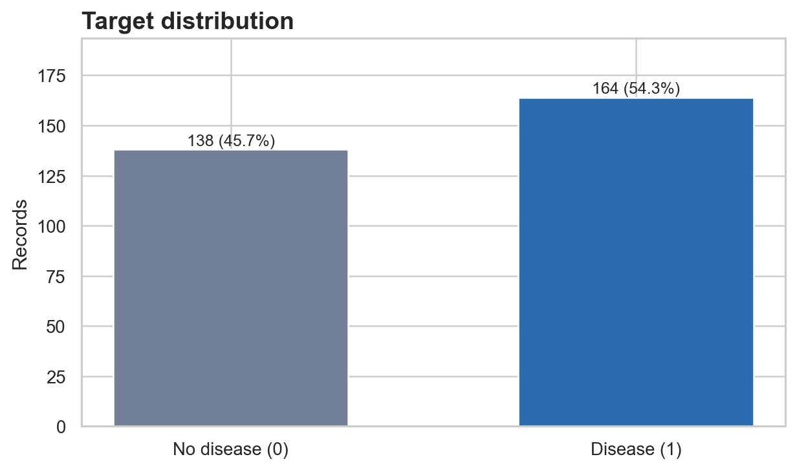
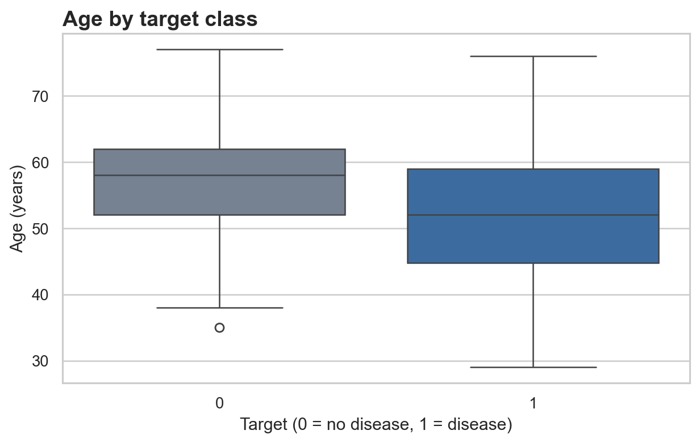
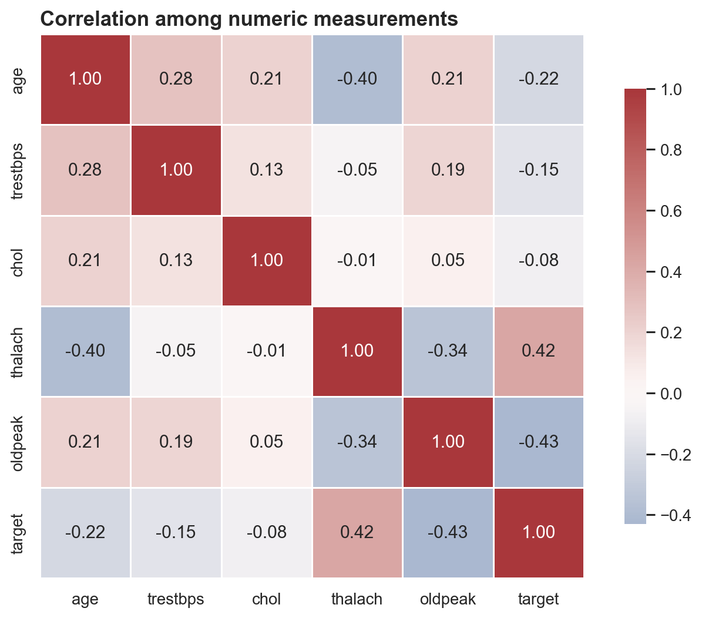
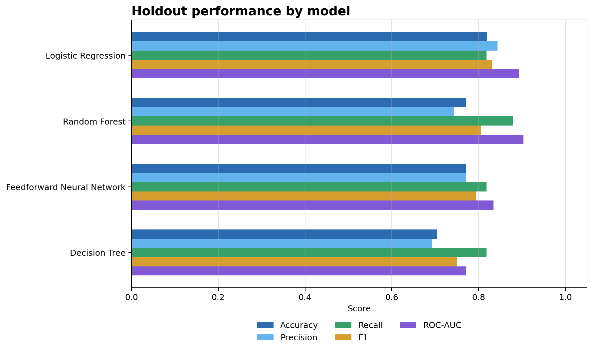
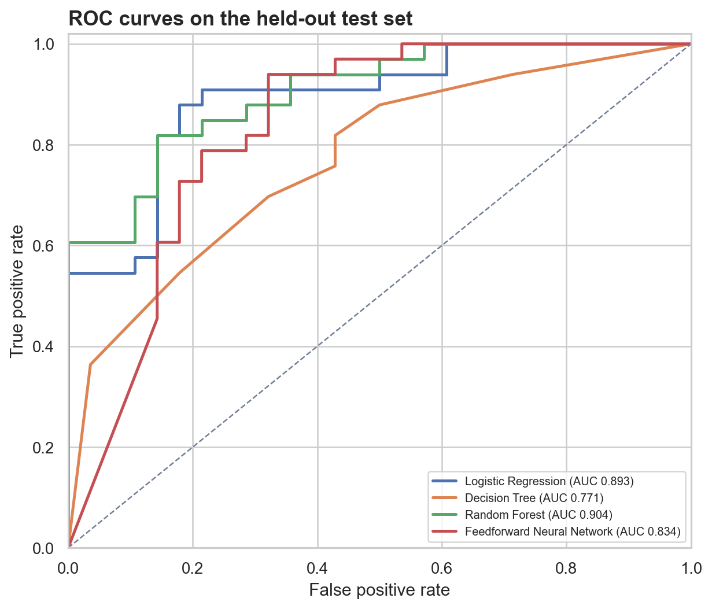
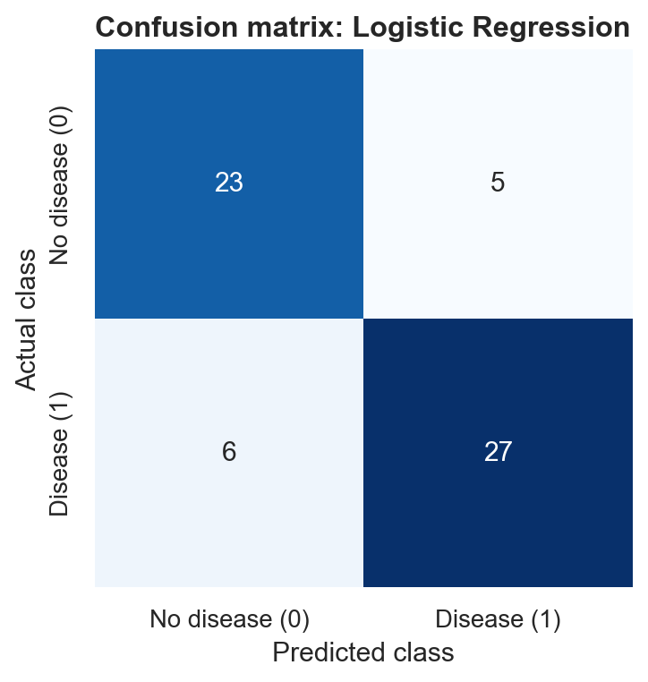
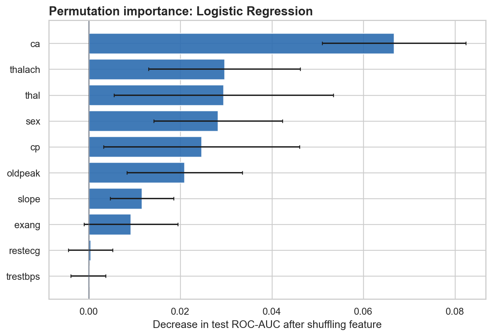

# Heart Disease Prediction Using Machine Learning Classification Models

## Major Project Report

Prepared from the supplied project brief and dataset | 25 October 2026

## Abstract

This project compares four supervised classifiers for predicting the supplied binary heart-disease target from 13 patient attributes. The worksheet contains 303 records and 14 columns; it has no missing cells and one exact duplicate row. After removing that duplicate, 302 records were used. A stratified 80/20 train/test split was used, and each model's hyperparameters were tuned by five-fold stratified cross-validation within the training data. Logistic Regression had the strongest mean cross-validation ROC-AUC (0.911) and was selected. On the held-out test set, it achieved 0.820 accuracy, 0.844 precision, 0.818 recall, 0.831 F1-score, and 0.893 ROC-AUC. The Random Forest had the highest test ROC-AUC (0.904), while its cross-validation ROC-AUC was 0.909. The difference illustrates the uncertainty of comparing models on a single small test set. These results are for an educational exercise and do not establish clinical performance.

## 1. Introduction and objectives

Heart disease prediction is framed here as a binary classification problem. The supplied brief calls for data cleaning, exploratory analysis, Logistic Regression, Decision Tree, Random Forest, and a simple neural network; hyperparameter tuning; accuracy, precision, recall, F1-score, and ROC-AUC; and feature-importance interpretation. A simple Streamlit interface is also included as the optional deployment component.

The project objectives were to:

1. inspect and prepare the supplied data;
2. explore the target distribution and selected feature relationships;
3. compare four tuned classification models using a held-out test set;
4. interpret the selected model with permutation importance; and
5. provide a reproducible training script and optional prediction demo.

## 2. Dataset and data preparation

The supplied worksheet has 303 records, 13 input features, and a binary `target` column. The target is used as provided: 0 and 1. There are 138 rows with target 0 and 165 with target 1 before duplicate removal. No missing values were found. One exact duplicate row was found and removed before analysis, leaving 302 unique rows (138 target-0 and 164 target-1); this reduces the chance that an identical row appears in both train and test partitions.

The file supplied under the name `heart.csv` is an Excel workbook with a worksheet named `in`, rather than a text CSV. The project package includes a proper CSV export of that worksheet and a copy of the original workbook bytes under an `.xlsx` extension. The 13 input columns are `age`, `sex`, `cp`, `trestbps`, `chol`, `fbs`, `restecg`, `thalach`, `exang`, `oldpeak`, `slope`, `ca`, and `thal`.

Five continuous measurement columns (`age`, `trestbps`, `chol`, `thalach`, `oldpeak`) were standardized. Eight discrete/code columns (`sex`, `cp`, `fbs`, `restecg`, `exang`, `slope`, `ca`, `thal`) were one-hot encoded so the model would not assume the codes form a numeric scale. The project retains all supplied code values. The exact source provenance and recoding history of the supplied workbook are not independently verified.

### Dataset summary after duplicate removal

| Item | Value |
|---|---:|
| Rows used | 302 |
| Input features | 13 |
| Target classes | 2 |
| Target 0 | 138 (45.7%) |
| Target 1 | 164 (54.3%) |
| Missing cells | 0 |
| Exact duplicate rows removed | 1 |

## 3. Methodology

The data was split into a stratified training set (241 rows) and test set (61 rows), with `random_state=42`. Each candidate used a scikit-learn pipeline. Numeric columns were median-imputed and scaled; coded categorical columns were imputed with their most frequent value and one-hot encoded. Although no missing cells occur in the supplied data, the imputation steps make the workflow robust to missing values in a future file.

Hyperparameters were tuned by grid search using five-fold stratified cross-validation on the training set only. The tuning score and model-selection criterion was mean ROC-AUC. The final estimator for each family was refit on the full training partition. All four final estimators were then evaluated on the same untouched test partition. Precision, recall, and F1 use class 1 as the positive class and the default 0.50 probability threshold.

| Model | Hyperparameters searched |
|---|---|
| Logistic Regression | `C`: 0.1, 1, 10; class weight: none or balanced |
| Decision Tree | depth: 3 or unlimited; leaf size: 2 or 5; class weight: none or balanced |
| Random Forest | 300 trees; depth: 6 or unlimited; leaf size: 1 or 3; class weight: none or balanced |
| Feedforward Neural Network | one or two hidden layers with 16 or 32 units; regularization (`alpha`): 0.0001 or 0.01 |

## 4. Results

The Logistic Regression model had the highest mean cross-validation ROC-AUC and was selected as the final model. Its selected settings were `C=0.1` and balanced class weights. The Random Forest's cross-validation score was close, and it obtained the best ROC-AUC on the single held-out test split. The test-set comparison is:

| Model | CV ROC-AUC | Accuracy | Precision | Recall | F1-score | Test ROC-AUC |
|---|---:|---:|---:|---:|---:|---:|
| Logistic Regression | 0.911 | 0.820 | 0.844 | 0.818 | 0.831 | 0.893 |
| Random Forest | 0.909 | 0.770 | 0.744 | 0.879 | 0.806 | 0.904 |
| Feedforward Neural Network | 0.874 | 0.770 | 0.771 | 0.818 | 0.794 | 0.834 |
| Decision Tree | 0.847 | 0.705 | 0.692 | 0.818 | 0.750 | 0.771 |

For the selected Logistic Regression model, the confusion matrix on 61 test rows was:

| Actual \ Predicted | Target 0 | Target 1 |
|---|---:|---:|
| Target 0 | 23 | 5 |
| Target 1 | 6 | 27 |

This corresponds to 23 true negatives, 5 false positives, 6 false negatives, and 27 true positives at the 0.50 threshold.

## 5. Feature-importance interpretation

Permutation importance was calculated on the held-out test data for the selected Logistic Regression model. It measures the change in ROC-AUC when one input column is shuffled while the other columns remain as observed. The largest mean decreases were associated with `ca` (0.067), `thalach` (0.030), `thal` (0.029), `sex` (0.028), and `cp` (0.025).

These values describe predictive contribution for this particular model and split. They do not show that a feature causes heart disease. Negative or near-zero values can occur on a small test set, especially when predictors overlap in the information they carry; they should not be interpreted as evidence that a measurement is protective.

## 6. Conclusion

The project completed the requested pipeline and compared Logistic Regression, Decision Tree, Random Forest, and a feedforward neural network. Logistic Regression was selected by five-fold training cross-validation and achieved 0.893 ROC-AUC on the held-out split. Random Forest's test ROC-AUC was 0.904, while its cross-validation score was slightly lower than Logistic Regression's. Given the small dataset and single holdout, this difference is not enough to claim that one model is reliably superior. Repeated or nested cross-validation and external validation would be needed for more stable performance estimates.

The optional Streamlit app loads the saved Logistic Regression pipeline and returns the model's class-1 probability and class label for entered dataset codes. The app is an educational demonstration only. It is not appropriate for clinical diagnosis, patient screening, or treatment decisions.

## 7. Limitations

- The analysis uses only 302 unique records from one supplied dataset.
- A single stratified holdout can produce variable estimates; the test set contains 61 records.
- The exact provenance and coding history of the supplied workbook are unknown. Numeric codes are therefore used as supplied rather than assigned unverified clinical labels.
- Dataset performance does not imply generalization to other hospitals, populations, time periods, or measurement practices.
- The project does not assess calibration, clinical utility, fairness, or consequences of false positives and false negatives.
- A high score on these data would not make this a validated medical prediction system.

## References

1. User-supplied project brief, *Heart Disease Prediction Using Machine Learning Classification Models*.
2. UCI Machine Learning Repository. (n.d.). *Heart Disease*. https://archive.ics.uci.edu/dataset/45/heart+disease. The supplied workbook's exact provenance is not confirmed.
3. Scikit-learn developers. (n.d.). *GridSearchCV*. https://scikit-learn.org/stable/modules/generated/sklearn.model_selection.GridSearchCV.html.
4. Scikit-learn developers. (n.d.). *MLPClassifier*. https://scikit-learn.org/stable/modules/generated/sklearn.neural_network.MLPClassifier.html.
